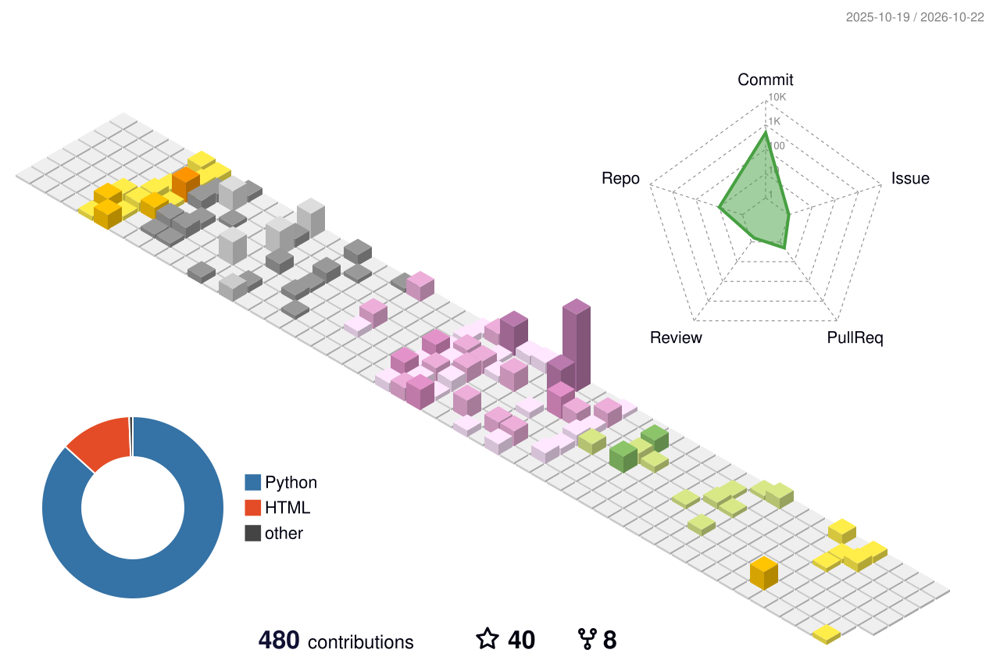

### 🧰 Technologies & Tools


<!-- -->


<!--START_SECTION:waka-->


**🐱 My GitHub Data** 

> 📦 1.6 MB Used in GitHub's Storage 
 > 
> 🏆 550 Contributions in the Year 2026
 > 
> 🚫 Not Opted to Hire
 > 
> 📜 16 Public Repositories 
 > 
> 🔑 22 Private Repositories 
 > 
**I'm a Night 🦉** 

```text
🌞 Morning                598 commits         ██░░░░░░░░░░░░░░░░░░░░░░░   08.61 % 
🌆 Daytime                2731 commits        ██████████░░░░░░░░░░░░░░░   39.33 % 
🌃 Evening                2501 commits        █████████░░░░░░░░░░░░░░░░   36.02 % 
🌙 Night                  1114 commits        ████░░░░░░░░░░░░░░░░░░░░░   16.04 % 
```
📅 **I'm Most Productive on Wednesday** 

```text
Monday                   1054 commits        ████░░░░░░░░░░░░░░░░░░░░░   15.18 % 
Tuesday                  1044 commits        ████░░░░░░░░░░░░░░░░░░░░░   15.03 % 
Wednesday                1187 commits        ████░░░░░░░░░░░░░░░░░░░░░   17.09 % 
Thursday                 1076 commits        ████░░░░░░░░░░░░░░░░░░░░░   15.50 % 
Friday                   888 commits         ███░░░░░░░░░░░░░░░░░░░░░░   12.79 % 
Saturday                 706 commits         ███░░░░░░░░░░░░░░░░░░░░░░   10.17 % 
Sunday                   989 commits         ████░░░░░░░░░░░░░░░░░░░░░   14.24 % 
```


📊 **This Week I Spent My Time On** 

```text
🕑︎ Time Zone: Asia/Shanghai

💬 Programming Languages: 
No Activity Tracked This Week

🔥 Editors: 
No Activity Tracked This Week

💻 Operating System: 
No Activity Tracked This Week
```

🤖 **AI Coding This Week** 

```text
No AI Coding Activity Tracked This Week
```

**I Mostly Code in Python** 

```text
Python                   27 repos            ████████████████░░░░░░░░░   64.29 % 
Jupyter Notebook         5 repos             ███░░░░░░░░░░░░░░░░░░░░░░   11.90 % 
TeX                      4 repos             ██░░░░░░░░░░░░░░░░░░░░░░░   09.52 % 
HTML                     2 repos             █░░░░░░░░░░░░░░░░░░░░░░░░   04.76 % 
Java                     1 repo              █░░░░░░░░░░░░░░░░░░░░░░░░   02.38 % 
```


 Last Updated on 29/10/2026 22:56:22 UTC
<!--END_SECTION:waka-->
